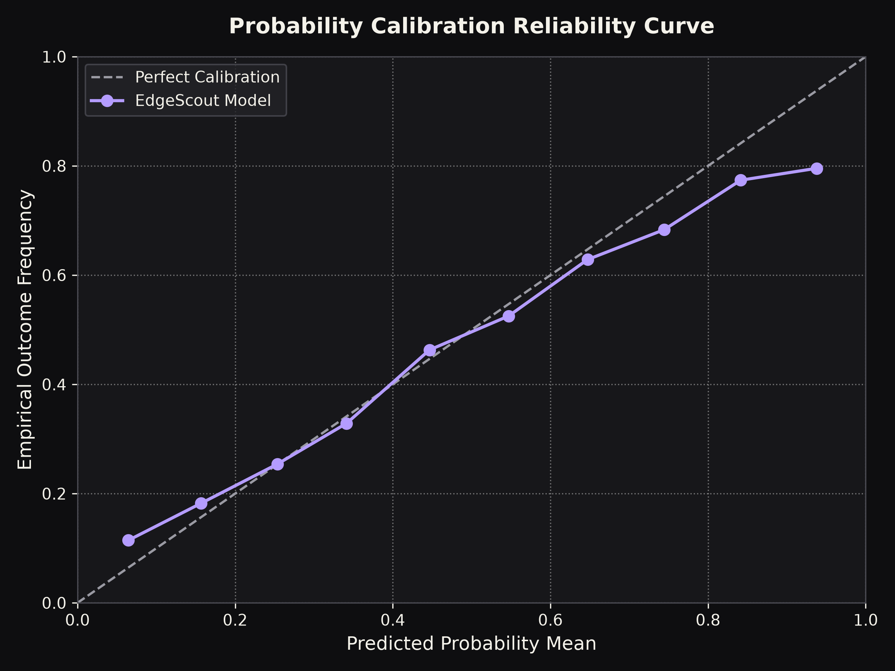

# EdgeScout Quantitative Backtest Report

**Evaluation Window:** 2021-09-14 to 2025-05-31  
**Total Matches Evaluated:** 7,382  
**Walk-Forward Folds:** 82

---

## 1. Probabilistic Evaluation (Strict Non-Accuracy Focus)

Unlike naive predictive models that headline win-loss prediction accuracy, EdgeScout evaluates probabilistic truth using strictly proper scoring rules.

| Metric | EdgeScout Model | Market De-Vigged (Shin) | Uniform Prior (1/3) | Interpretation |
| :--- | :--- | :--- | :--- | :--- |
| **Multiclass Log Loss** | `1.0024` | `0.9748` | `1.0986` | Quantifies negative log probability of the true outcome (lower is superior). |
| **Brier Score** | `0.5967` | `0.5803` | `0.6667` | Mean squared error of probability vector against one-hot outcome. |
| **Expected Calibration Error (ECE)** | `0.0168` | N/A | N/A | Weighted absolute difference between confidence and empirical reality. |

---

## 2. Probability Calibration (Reliability Diagram)

A well-calibrated model ensures that among events assigned an x% probability, approximately x% occur in reality.

| Probability Bin | Matches In Bin | Predicted Mean | Empirical Win Frequency | Absolute Error |
| :--- | :--- | :--- | :--- | :--- |
| `0.0-0.1` | 1,171 | `0.0645` | `0.1144` | `0.0500` |
| `0.1-0.2` | 3,356 | `0.1565` | `0.1821` | `0.0256` |
| `0.2-0.3` | 6,925 | `0.2537` | `0.2542` | `0.0005` |
| `0.3-0.4` | 4,586 | `0.3414` | `0.3286` | `0.0128` |
| `0.4-0.5` | 2,339 | `0.4466` | `0.4630` | `0.0165` |
| `0.5-0.6` | 1,659 | `0.5468` | `0.5250` | `0.0218` |
| `0.6-0.7` | 1,098 | `0.6471` | `0.6284` | `0.0187` |
| `0.7-0.8` | 650 | `0.7442` | `0.6831` | `0.0611` |
| `0.8-0.9` | 274 | `0.8414` | `0.7737` | `0.0677` |
| `0.9-1.0` | 88 | `0.9376` | `0.7955` | `0.1421` |

---

## 3. Flat-Stake Performance Across Edge Thresholds

Simulating flat 100-unit stakes across matches where the model estimated expected value $\ge$ threshold:

| Edge Threshold | Qualifying Bets | Total Staked | Net P/L | ROI (%) | Avg Model Edge | Avg CLV | Beat Closing Line % |
| :--- | :--- | :--- | :--- | :--- | :--- | :--- | :--- |
| **2.0%** | 7,895 | ₦789,500.00 | ₦-56,307.00 | **-7.13%** | 20.76% | +0.40% | 38.3% |
| **3.0%** | 7,472 | ₦747,200.00 | ₦-52,595.00 | **-7.04%** | 21.80% | +0.43% | 38.4% |
| **5.0%** | 6,642 | ₦664,200.00 | ₦-50,708.00 | **-7.63%** | 24.02% | +0.42% | 37.9% |
| **8.0%** | 5,613 | ₦561,300.00 | ₦-39,005.00 | **-6.95%** | 27.24% | +0.50% | 37.8% |
| **10.0%** | 4,945 | ₦494,500.00 | ₦-34,387.00 | **-6.95%** | 29.71% | +0.49% | 37.5% |

---

## 4. Closing Line Value (CLV) Analysis
Closing Line Value is the gold standard benchmark in professional quantitative sports betting. Because closing lines represent the aggregate consensus of all sharp syndicates and liquidity right before kickoff, consistently beating the closing line is mathematical proof of finding pricing discrepancies.

---
*Generated automatically by EdgeScout Phase 1 Engine.*
